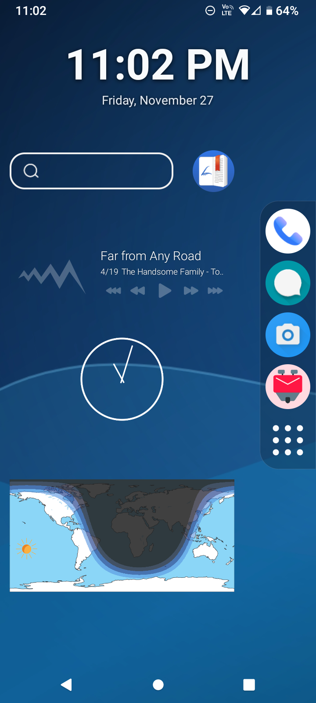
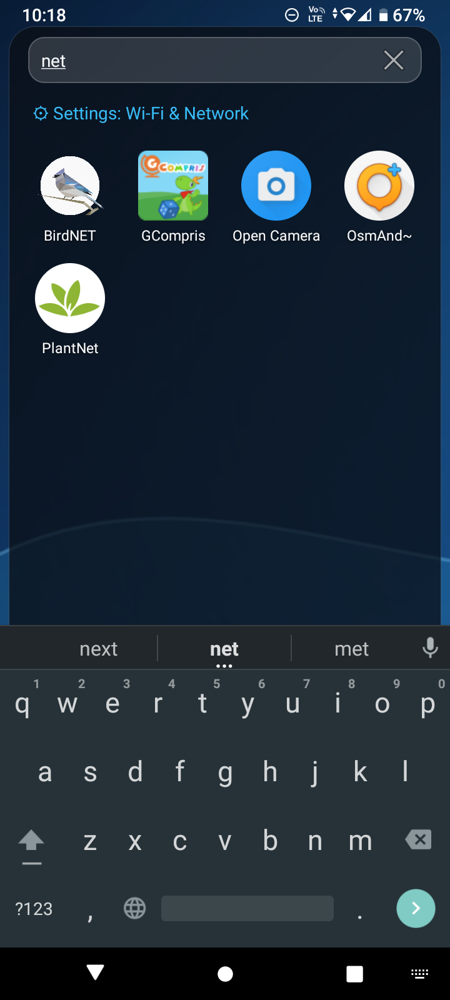
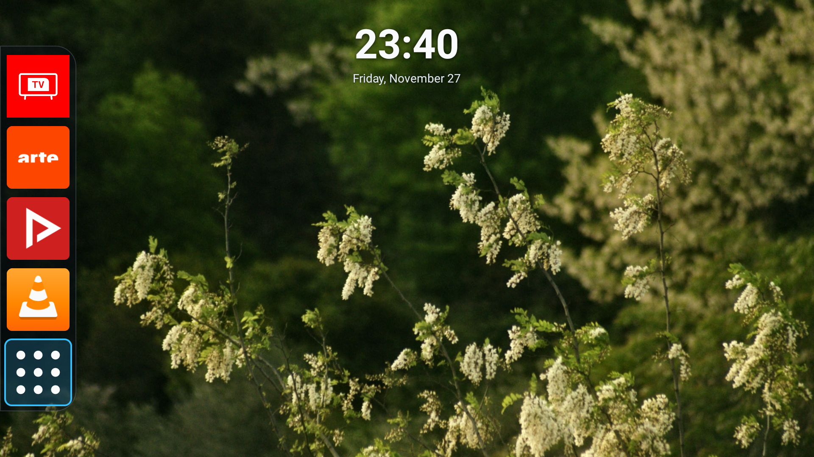
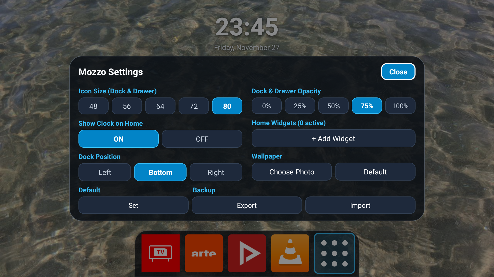

# Mozzo Launcher

[🇬🇧 English](README.md) | 🇮🇹 Italiano


Un launcher Android veloce e minimale progettato sia per **smartphone che per Android TV** (da Android 7.0 Nougat / API 24 in poi), ispirato al flusso di lavoro pulito di **GNOME 3**.

---

## ✨ Perché l'ho creato

Molti launcher per smartphone risultano disordinati, mentre molti launcher per Android TV sono lenti e pieni di pubblicità. Volevo un unico launcher essenziale, leggero, pulito su qualsiasi formato di schermo e comodo sia al tocco che con il telecomando TV (D-Pad).

Ho progettato personalmente idea e flusso di utilizzo e sviluppato il codice con l'aiuto dell'AI per superare i limiti dei launcher esistenti, dando priorità a velocità, pulizia visiva e zero appesantimenti.

---

## 🚀 Funzionalità principali

- **Dock e Drawer stile GNOME 3:** Dock (`Sinistra` / `Basso` / `Destra`) con 4 preferiti iniziali automatici, fino a 8 app o impostazioni rapide fissabili, modalità **Sposta** continua, dimensione icone (`48–80 dp`) e opacità pannelli (`0%–100%`) regolabili.
- **Drawer essenziale e ricerca istantanea:** Griglia ordinata su una riga con ricerca immediata tra le app installate (incluse app Leanback TV e collegamenti web) e 14 scorciatoie integrate alle impostazioni di sistema.
- **Griglia Widget ordinata e Orologio:** Orologio 12h/24h opzionale in alto, griglia widget a 4 colonne in verticale / 6 in orizzontale, selettore raggruppato con dimensioni in celle (`L × A`) e controlli **Sposta** / **Ridimensiona** (`W-`, `W+`, `H-`, `H+`, `Fatto` + frecce telecomando).
- **Sfondo reale di sistema e fallback TV:** Su telefono integra lo sfondo di sistema per transizioni fluide con blocco schermo e app recenti, con selettore foto personalizzata e sfondo a onda predefinito per Android TV.
- **Backup e ripristino:** Esportazione e importazione in JSON (`mozzo-launcher-backup.json`) di tutte le impostazioni, preferiti della dock e collegamenti web, più pulsante diretto per impostare Mozzo come launcher predefinito.
- **Multilingua (8 lingue):** Italiano, Inglese, Spagnolo, Francese, Tedesco, Portoghese, Olandese e Cinese semplificato.
- **Leggero e privato:** Nessuna pubblicità, nessuna telemetria, nessun permesso internet, avvio rapido e APK compatto.

---

## 📸 Screenshot

### Smartphone
<p align="center">
  
  
</p>

### Android TV
<p align="center">
  
  
</p>

---

## 📥 Download e Installazione

> **Requisito minimo:** Android **7.0 (Nougat, API 24)** o superiore.

### Smartphone

1. Vai alla pagina [Releases](../../releases) e scarica l'ultimo file `.apk`.
2. Installa l'APK (abilita **Installa app sconosciute** se richiesto).
   - *Nota: poiché l'app è distribuita direttamente su GitHub e non tramite Google Play, al primo avvio Google Play Protect può chiedere di effettuare una scansione di sicurezza dell'APK. È un comportamento normale per le app installate manualmente.*
3. Premi il tasto **Home** e imposta **Mozzo Launcher** come predefinito (oppure usa **Predefinito → Imposta** nelle Impostazioni Mozzo).
   - *Consiglio: supporta il tracciamento automatico degli aggiornamenti tramite **Obtainium**.*

### Android TV / Google TV (Impostazione come Launcher Predefinito)

Molti dispositivi Android TV e Google TV bloccano il launcher predefinito ignorando il selettore di sistema. Per aprire automaticamente Mozzo Launcher alla pressione del tasto Home:

1. Installa il file `.apk` dalle [Releases](../../releases) sulla tua TV (es. tramite chiavetta USB o app di trasferimento file).
2. Installa un remapper per i tasti da Google Play o F-Droid — come **Button Mapper** (di flar2) oppure l'open-source **Key Mapper** — e attiva il relativo servizio di Accessibilità quando richiesto.
3. Associa il tasto **Home** (tocco singolo) all'avvio di **Mozzo Launcher**.
4. *Alternativa (senza app aggiuntive):* attiva il Debug USB/di rete sulla TV e disattiva il launcher di sistema tramite ADB da PC:
   ```bash
   adb shell pm disable-user --user 0 <stock.launcher.package>
   ```

---

## 🛠 Compilazione e Test

Requisiti: **JDK 21**, **Android SDK (API 36)** e **Gradle**.

```bash
gradle :app:testDebugUnitTest
gradle :app:assembleDebug
```

---

## 📄 Licenza

Distribuito sotto [GNU General Public License v3.0 (GPLv3)](LICENSE).
