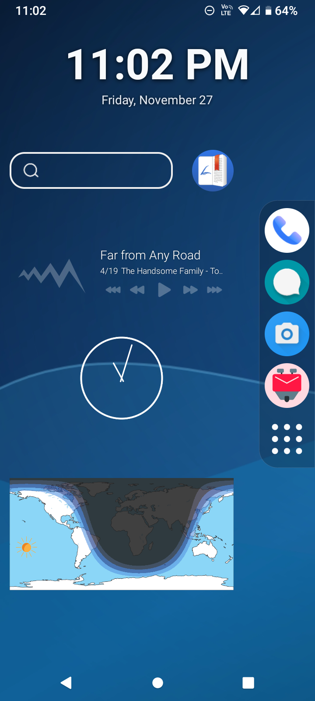
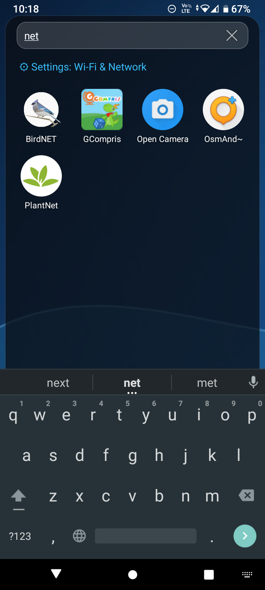
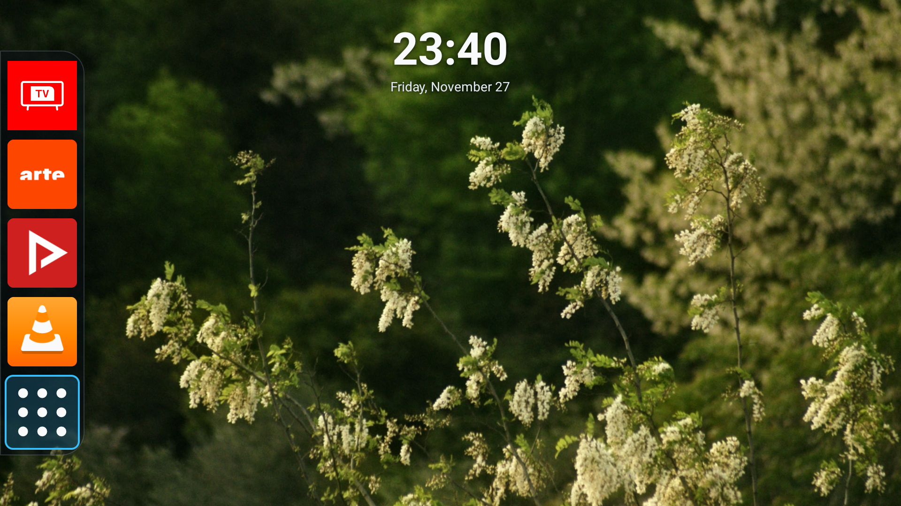
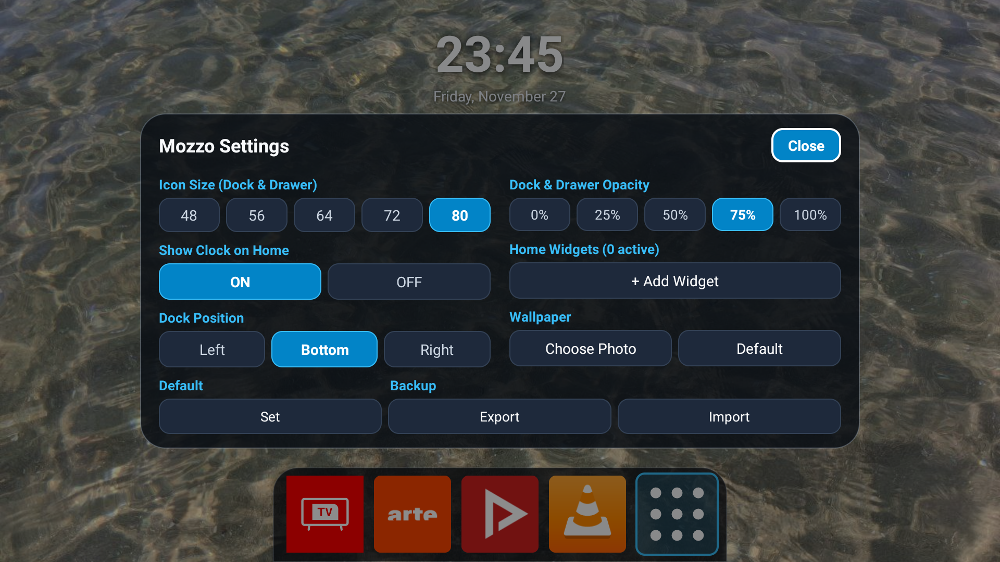

# Mozzo Launcher


A fast, minimalist Android launcher designed for both **smartphones and Android TV** (Android 7.0 Nougat / API 24 and newer), inspired by the clean desktop workflow of **GNOME 3**.

---

## ✨ Why I built this

Most smartphone launchers feel cluttered, while many Android TV launchers are slow and full of ads. I wanted a single, distraction-free launcher that stays lightweight, looks clean on any screen size, and works smoothly with both touch and a TV remote (D-Pad).

I designed the concept and workflow myself and built the codebase with the help of AI to overcome the limits of existing launchers—prioritizing speed, clean design, and zero bloat.

---

## 🚀 Key Features

- **GNOME 3-inspired dock & drawer:** Dock (`Left` / `Bottom` / `Right`) with auto-populated starter favorites, up to 8 pinned apps or system setting shortcuts, continuous **Move** mode, adjustable icon size (`48–80 dp`) and panel opacity (`0%–100%`) across the Dock, App Drawer, and Settings panel.
- **Essential App Drawer & Instant Search:** Compact single-line icon grid with live search across installed apps (including Leanback TV apps and web shortcuts) and 14 built-in Android system setting shortcuts.
- **Free-Grid Widgets & Home Clock:** Optional centered 12h/24h Home Clock, 4-column portrait / 6-column landscape widget grid sized automatically to each widget's declared dimensions, grouped widget preview picker (`W × H`), and 2D **Move** controls (`◀`, `▲`, `▼`, `▶`, `Done`, D-Pad arrows, or tap any empty grid slot).
- **System Wallpaper & TV Fallback:** Uses Android's real system wallpaper on phones for seamless lockscreen and recents transitions, plus custom photo picker and a built-in wave wallpaper fallback for Android TV.
- **Backup & Restore:** Export and import all launcher preferences, dock favorites, and web shortcuts to JSON (`mozzo-launcher-backup.json`), plus a direct shortcut to set Mozzo as your default Home app.
- **Multilingual UI (8 languages):** English, Italiano, Español, Français, Deutsch, Português, Nederlands, 中文.
- **Lightweight & private:** No ads, no analytics, no internet permission, fast startup, small APK footprint.

---

## 📸 Screenshots

### Smartphone
<p align="center">
  
  
</p>

### Android TV
<p align="center">
  
  
</p>

---

## 📥 Download & Install

> **Minimum requirement:** Android **7.0 (Nougat, API 24)** or higher.

### Smartphones

1. Go to the [Releases](../../releases) page and download the latest `.apk`.
2. Install the APK (enable **Install unknown apps** if prompted).
   - *Note: Since this app is distributed directly via GitHub rather than Google Play, Google Play Protect may ask to scan the APK during the first installation. This is normal for sideloaded apps.*
3. Press the **Home** button and set **Mozzo Launcher** as your default launcher (or use **Default → Set** in Mozzo Settings).
   - *Tip: Supports automatic update tracking via **Obtainium**.*

### Android TV / Google TV (Setting as Default Launcher)

Many Android TV and Google TV devices lock the stock launcher and ignore the system Home picker. To make Mozzo Launcher open automatically when you press the Home button:

1. Install the `.apk` from [Releases](../../releases) on your TV (e.g., via USB drive or a file transfer app).
2. Install a button remapper from Google Play or F-Droid — such as **Button Mapper** (by flar2) or the open-source **Key Mapper** — and enable its Accessibility Service when prompted.
3. Map the **Home** button (Single Tap) to launch **Mozzo Launcher**.
4. *Alternative (No extra apps required):* Enable USB/Network Debugging on your TV and disable the stock launcher via ADB from a PC:
   ```bash
   adb shell pm disable-user --user 0 <stock.launcher.package>
   ```

---

## 🛠 Building & Testing

Prerequisites: **JDK 21**, **Android SDK (API 36)**, and **Gradle**.

```bash
gradle :app:testDebugUnitTest
gradle :app:assembleDebug
```

---

## 📄 License

Distributed under the [GNU General Public License v3.0 (GPLv3)](LICENSE).
